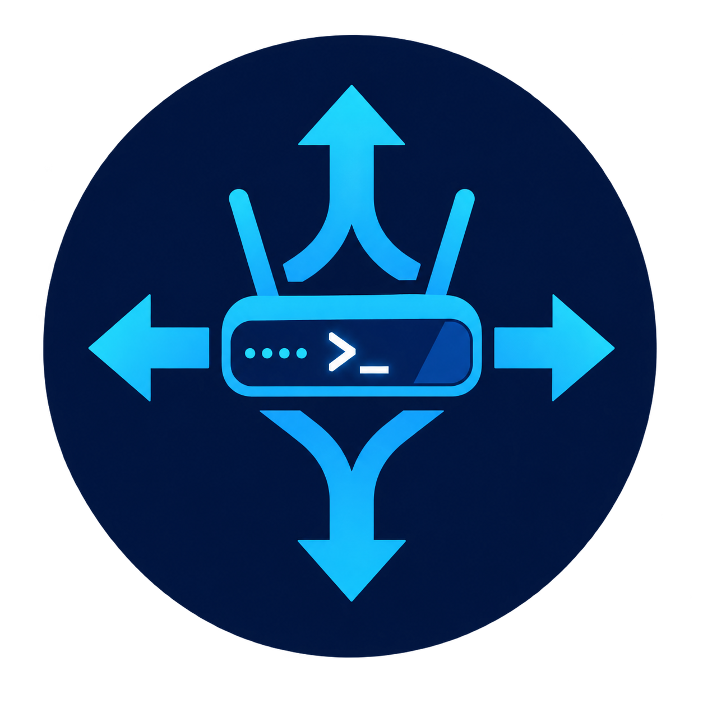

# 🛰️ PowerBGP

<p align="center"></p>

[](https://www.powershellgallery.com/packages/PowerBGP)

Stand up **BGP** and **BFD** test peers straight from PowerShell, and craft any packet byte by byte. 🧪

PowerBGP speaks just enough BGP-4 (RFC 4271) and BFD (RFC 5880) to peer with a real router, so you can test against VMware Cloud Foundation (NSX) edge clusters, Windows Server BGP, MikroTik, Cisco or any other RFC-compliant BGP engine without lab gear on the other end. It is written entirely in PowerShell, with no binaries or dependencies.

- 🤝 Establish sessions, advertise and withdraw prefixes, and watch what the neighbour sends you
- ⏱️ Run BFD alongside BGP and see how the router reacts when the session drops
- 💥 Inject faults (stop keepalives, send malformed messages) to test how the other side copes
- 🧱 Build and parse OPEN, UPDATE, NOTIFICATION, KEEPALIVE and BFD control packets as plain `byte[]`
- 🔧 Generic packet builder (`New-Packet`) for anything else you want to hand-craft

> ℹ️ **Status:** 0.5, a test tool. Not a routing daemon. It does not install routes or forward traffic.

> ⚠️ **Lab use only.** Do not point PowerBGP at production routers or networks. It can advertise arbitrary prefixes and send malformed messages on purpose. Saved configs (`Export-BgpConfig`) store MD5 passwords in clear text, and the companion web UI/REST API has no authentication.

## 📋 Requirements

- PowerShell 7.4 or later (Windows, Linux, macOS)
- TCP-MD5 passwords (RFC 2385) need PowerShell on **Linux**; the Windows TCP stack cannot do it
- Binding to port 179 may need elevated rights; use `-Port` for a high port while testing

## 📦 Install

```powershell
Install-Module PowerBGP -Scope CurrentUser
Import-Module PowerBGP
```

## 🚀 Quick start

Peer with a router, advertise a prefix and look at the result:

```powershell
Start-BgpSession -Name lab -RemoteAddress 192.168.1.1 -RemoteAS 65000 `
              -LocalAS 65001 -RouterId 192.168.1.50

# Sessions redial after a drop by default; add -AutoReconnect:$false to stay down

Get-BgpSession                                    # State, Learned and Advertised counts

Send-BgpUpdate -Name lab -Nlri 10.10.0.0/24 -NextHop 192.168.1.50 -AsPath 65001

Get-BgpRoute -Name lab -Direction Learned      # what the neighbour advertises to us
Get-BgpRoute -Name lab -Direction Advertised   # what we advertise to it

Send-BgpUpdate -Name lab -Withdrawn 10.10.0.0/24
Stop-BgpSession lab                               # Cease; config is kept
Resume-BgpSession lab                             # restart, routes are re-sent
Remove-BgpSession lab                             # delete it
```

Passive mode, to have the router connect to you:

```powershell
Start-BgpSession -Name inbound -Passive -RemoteAddress 192.168.1.1 -RemoteAS 65000 -LocalAS 65001 -RouterId 192.168.1.50
```

### Inbound route filters

Filter what a session accepts. Rules are checked in order, first match wins, and anything unmatched gets `-InboundDefault` (`Permit` unless you say otherwise). Denied routes never reach `Get-BgpRoute`; `Get-BgpSession` counts them in `Filtered`.

```powershell
$filter = @(
    New-BgpFilterRule -Action Deny   -Prefix 10.0.0.0/8 -Le 32      # anything inside 10/8
    New-BgpFilterRule -Action Deny   -Prefix 0.0.0.0/0              # the default route (exact match)
    New-BgpFilterRule -Action Permit -AsPathContains 65100
)
Start-BgpSession -Name lab -RemoteAddress 192.168.1.1 -RemoteAS 65000 -LocalAS 65001 `
                 -RouterId 192.168.1.50 -InboundFilter $filter -InboundDefault Permit

Update-BgpSession -Name lab -InboundFilter $filter -InboundDefault Deny   # restarts the session
```

A rule can match on `-Prefix` (with `-Ge`/`-Le` for length ranges, like a prefix-list), `-AsPathContains` and `-Community`; all conditions on a rule must match.

### IPv6 (MP-BGP)

Add `-AddressFamily IPv6` to advertise the IPv6 unicast capability (RFC 4760). IPv6 prefixes then travel in `MP_REACH_NLRI` / `MP_UNREACH_NLRI`, and the session itself can run over IPv4 or IPv6.

```powershell
Start-BgpSession -Name v6 -RemoteAddress 2001:db8::1 -RemoteAS 65000 -LocalAS 65001 -RouterId 192.168.1.50 `
                 -AddressFamily IPv4, IPv6
Send-BgpUpdate -Name v6 -Nlri 2001:db8:10::/48 -NextHop 2001:db8::50
Send-BgpUpdate -Name v6 -Nlri 10.10.0.0/24                 # IPv4 still works on the same session
```

Over an IPv4 session, `-NextHop` must be given explicitly for IPv6 prefixes. Inbound filters understand IPv6 prefixes too.

### Several sessions to one router (ECMP tests)

PowerBGP does no best-path selection itself, but it can make a router see equal-cost paths. Bind each session to its own source address with `-LocalAddress`, peer with the router from each, and advertise the same prefix with the same attributes:

```powershell
'192.168.1.50', '192.168.1.51' | ForEach-Object {
    Start-BgpSession -Name "ecmp-$_" -RemoteAddress 192.168.1.1 -RemoteAS 65000 -LocalAS 65001 `
                     -RouterId $_ -LocalAddress $_ -AutoReconnect
}
# the router needs a neighbour entry for each source address
Send-BgpUpdate -Name ecmp-192.168.1.50 -Nlri 10.200.0.0/24 -NextHop 192.168.1.50 -AsPath 65001
Send-BgpUpdate -Name ecmp-192.168.1.51 -Nlri 10.200.0.0/24 -NextHop 192.168.1.51 -AsPath 65001
```

Then check on the router that both next hops are installed. Use different `-LocalAS` values per session to exercise multi-AS multipath.

### Lots of routes

```powershell
Send-BgpUpdate -Name lab -Nlri (New-BgpPrefixRange -Base 10.100.0.0 -Count 5000 -Length 24)
```

Prefixes are packed into as many UPDATEs as needed.

### BFD

```powershell
Start-BfdSession -Name lab-bfd -RemoteAddress 192.168.1.1 -DesiredMinTxMs 300 -RequiredMinRxMs 300 -DetectMult 3
Get-BfdSession                      # State and RemoteState
Set-BfdSession lab-bfd -Suppress $true   # go silent and watch the router tear down the session
```

Many routers (for example MikroTik) only run BFD toward you while the BGP session is up and BFD is enabled for that peer.

Single-hop BFD (RFC 5881, UDP 3784) requires the packet to arrive with TTL 255, so the peer must be on the same L2 segment. For a routed path use `-MultiHop` (RFC 5883, UDP 4784), and pin the source address with `-LocalAddress` when the host has several IPs:

```powershell
Start-BfdSession -Name nsx-bfd -RemoteAddress 10.0.0.2 -LocalAddress 10.0.0.9 -MultiHop
```

### Fault injection and crafted messages

```powershell
Set-BgpSession -Name lab -SuppressKeepalives $true      # let the remote hold timer expire

$bad = New-BgpNotification -Code 3 -Subcode 1        # UPDATE Message Error
Send-BgpMessage -Name lab -Bytes $bad
```

### Packet crafting only

```powershell
$o = New-BgpOpen -AS 65001 -RouterId 10.0.0.1 -HoldTime 90
$o | Format-Packet                 # hex dump to compare with Wireshark
ConvertFrom-BgpMessage $o          # parse it back

New-Packet -LengthField Len -Field @(
    New-PacketField Len  0 -Bytes 2
    New-PacketField Type 7 -Bytes 1
    New-PacketField Data 'DEADBEEF'
)
```

`New-PacketField` and `New-Packet` are generic: integers are written big-endian, hex strings become raw bytes, and a length field can be filled in automatically.

### Inspect the conversation

```powershell
Get-BgpEvent -Name lab | Select-Object -Last 10    # last 500 sent/received messages per peer
```

### Save and restore peers

```powershell
Export-BgpConfig -Path peers.json
Import-BgpConfig -Path peers.json
```

MD5 passwords are saved in **clear text**. Keep the file out of source control.

## 🧰 Cmdlets

| Area | Cmdlets |
| --- | --- |
| Packet builder | `New-PacketField`, `New-Packet`, `Format-Packet` |
| BGP messages | `New-BgpOpen`, `New-BgpUpdate`, `New-BgpKeepalive`, `New-BgpNotification`, `ConvertFrom-BgpMessage`, `New-BgpPrefixRange`, `New-BgpFilterRule` |
| BFD packets | `New-BfdControl`, `ConvertFrom-BfdControl` |
| BGP sessions | `Start-BgpSession`, `Get-BgpSession`, `Update-BgpSession`, `Stop-BgpSession`, `Resume-BgpSession`, `Remove-BgpSession`, `Send-BgpUpdate`, `Send-BgpMessage`, `Set-BgpSession`, `Get-BgpRoute`, `Get-BgpEvent` |
| BFD sessions | `Start-BfdSession`, `Get-BfdSession`, `Update-BfdSession`, `Stop-BfdSession`, `Resume-BfdSession`, `Remove-BfdSession`, `Set-BfdSession` |
| Config | `Export-BgpConfig`, `Import-BgpConfig` |

Use `Get-Help <cmdlet> -Examples` for details.

## ⚙️ How it works

Each peer runs its finite state machine (Idle, Connect, Active, OpenSent, OpenConfirm, Established) in its own runspace, so cmdlets return immediately and sessions keep running in the background. State is kept in memory and shared through one registry, so everything is lost when the PowerShell process exits.

## ✅ Tested against

| Target | What was verified |
|--------|-------------------|
| MikroTik RouterOS v7 | BGP reaching Established, auto-reconnect, route advertisement, BFD Up/Up (needs `use-bfd=yes` and a `/routing/bfd/configuration` entry) |
| VMware NSX edge (Tier-0 gateway) | BFD Up, both single-hop (same L2 segment, TTL 255) and `-MultiHop` (UDP 4784) |
| PowerBGP against itself (loopback) | BGP, MP-BGP IPv6, inbound filters, BFD, stop/resume, and TCP-MD5 in a Linux container |
| CI | Pester on Ubuntu and Windows with PowerShell 7.4 and 7.5 |

Not yet tested against real gear: BGP toward NSX, Windows Server BGP, Cisco, IPv6 on a real router, and TCP-MD5 against a real peer. Reports are welcome.

## 🚧 Limitations

- IPv4 and IPv6 unicast only (no VPN, EVPN or other address families)
- No route processing: learned routes are recorded, never installed
- BFD is asynchronous mode only; it answers a Poll with Final but never initiates one, and there is no authentication
- TCP-MD5 is Linux only and IPv4 only
- Nothing persists across restarts except what you export yourself

## 🐳 Container

A `Containerfile` is included for running PowerBGP in a PowerShell container (tested with rootful Podman):

```bash
podman build -f Containerfile -t powerbgp .
podman run -it --rm --network host powerbgp
```

Host networking lets sessions reach your lab devices, and the container runs as root so it can bind port 179.

## 🧪 Tests

```powershell
Invoke-Pester ./Tests
```

The session tests run two PowerBGP peers against each other over loopback, so no router is needed.

## 🖥️ Web UI

A Pode.Web dashboard and REST API are available as a separate project, [PowerBGP.Pode](https://github.com/erikgraa/PowerBGP.Pode).

## 📄 License

MIT, see [LICENSE](LICENSE).
